# Задание 2. Динамическое масштабирование

## Запуск

```bash
minikube start -p scaletest
minikube addons enable metrics-server -p scaletest
minikube stop -p scaletest
```

Все ресурсы в namespace `scaletest`. Образ `scaletestapp:local` собрал из исходников scaletestapp, поэтому `imagePullPolicy: Never`.

## Часть 1. Масштабирование по памяти
### Приложение и сервис

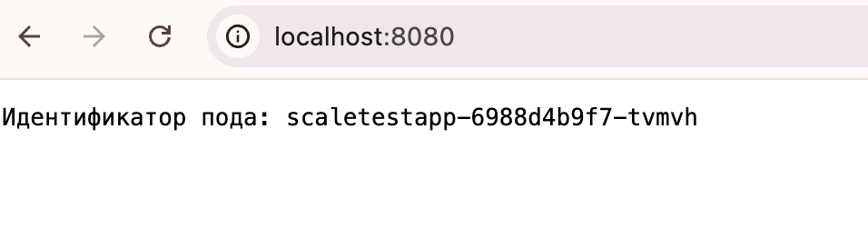
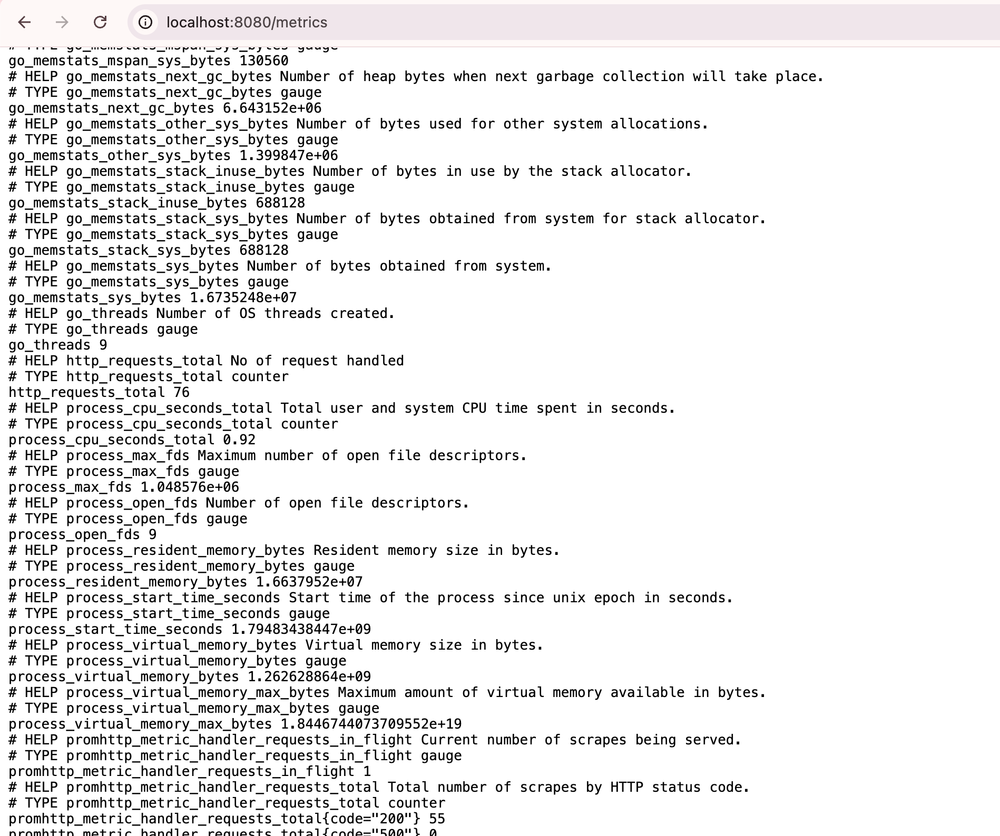

Под без нагрузки занимает 11Mi:

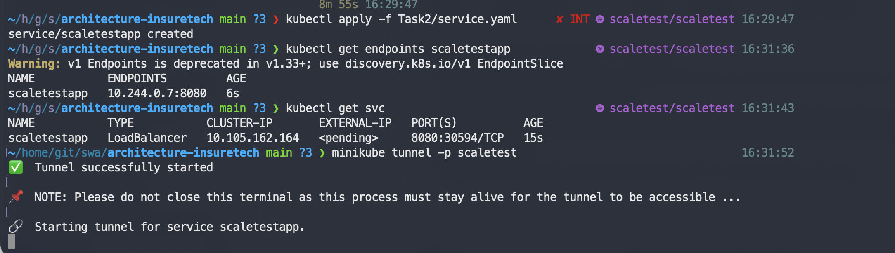

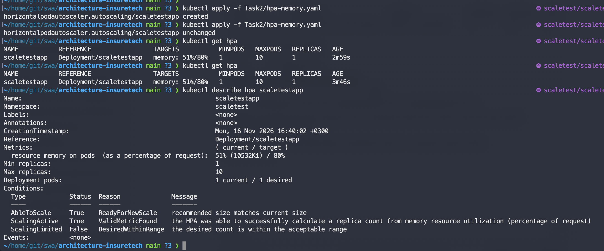

### Нагрузка

1. Сначала запускал Locust локально через туннель (`http://127.0.0.1:8080`), 100 -> 1500 пользователей. Память выросла с 31% до 91%, HPA добавил второй под. Через туннель 26% ошибок, поэтому решил попробовать запустить Locust в кластере.

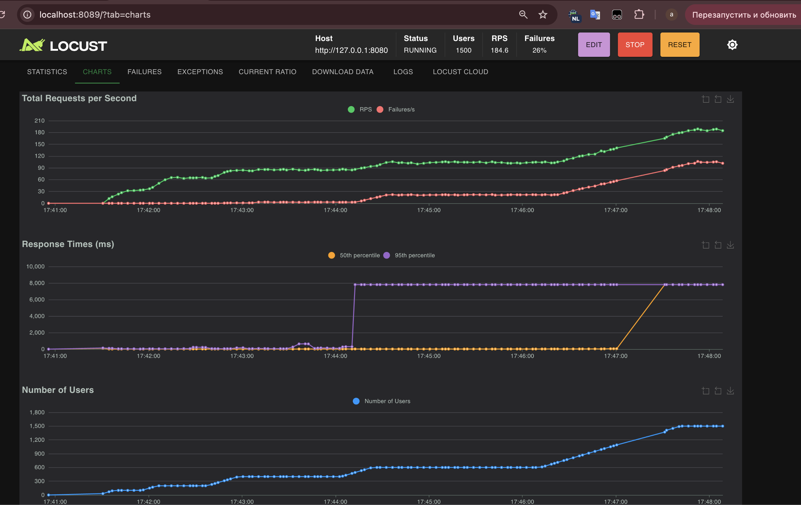


2. Locust в кластере (`http://scaletestapp:8080`), до 8000 пользователей, 0% ошибок. Память дошла до 104%, HPA увеличил число подов 2 -> 3 -> 4 -> 5 -> 7 -> 10 (максимум).


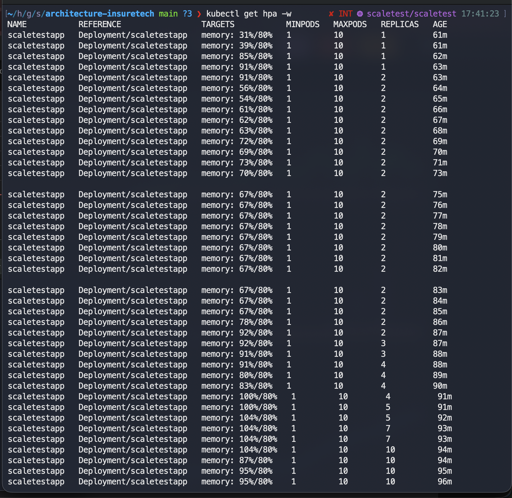

Вывод HPA: [hpa-memory-describe.txt](artifacts/hpa-memory-describe.txt), события: [hpa-memory-events.txt](artifacts/hpa-memory-events.txt).

3. Нагрузку выключил, а поды не удаляются: память после нагрузки не освобождается, в среднем около 105% от request. HPA считает, что поды все еще нужны.

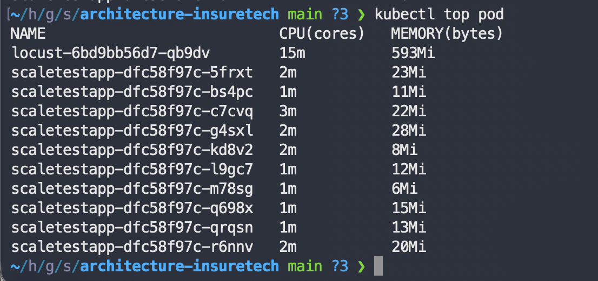

Вывод: по памяти HPA масштабирует вверх, но не вниз. Для этого приложения память плохо отражает нагрузку.

## Часть 2. Масштабирование по RPS

- [kube-prometheus-stack-values.yaml](kube-prometheus-stack-values.yaml) - Prometheus + Grafana через helm.
- [servicemonitor.yaml](servicemonitor.yaml) - Prometheus собирает `/metrics` с каждого пода раз в 15 с
- [prometheus-adapter-values.yaml](prometheus-adapter-values.yaml) - адаптер превращает счетчик `http_requests_total` в `http_requests_per_second` (rate за 1 мин по каждому поду) и отдает его в Kubernetes через custom metrics API
- [hpa-rps.yaml](hpa-rps.yaml) - HPA: в среднем 10 RPS на под, от 1 до 10 подов; при спаде нагрузки ждет 60 с и убирает не больше 50% подов за 30 с

### Prometheus

Все 10 подов приложения в Targets в статусе UP:
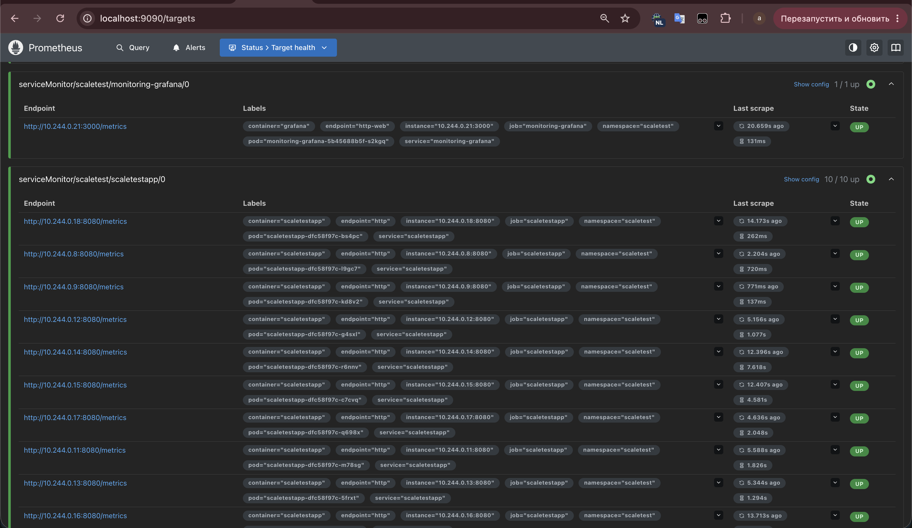

Счетчик `http_requests_total` по каждому поду:
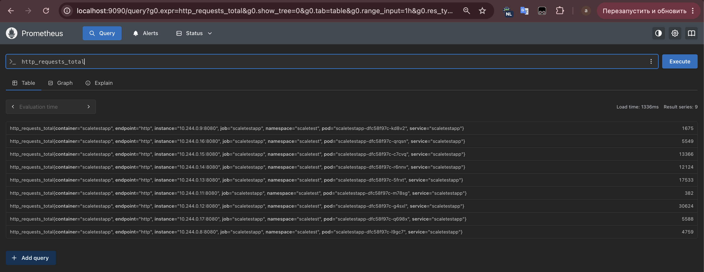

RPS по подам в Grafana под нагрузкой Locust (1000 пользователей):
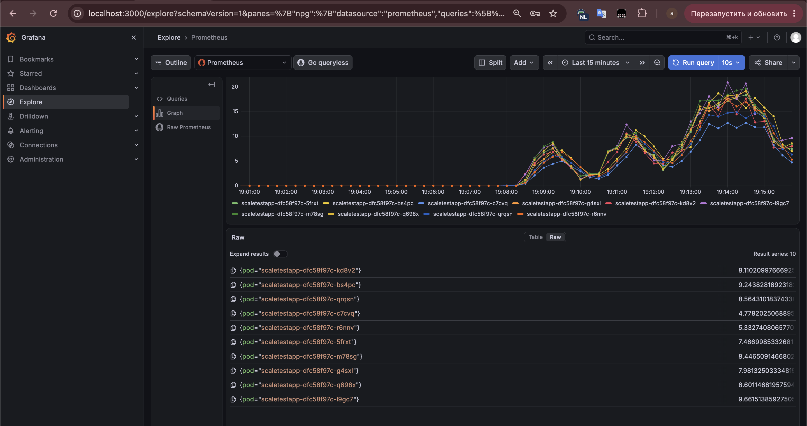
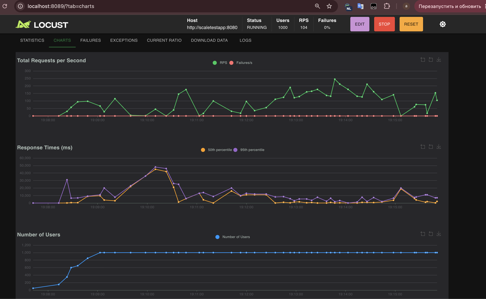

### Адаптер

API custom metrics доступен, в нем есть `pods/http_requests_per_second`:
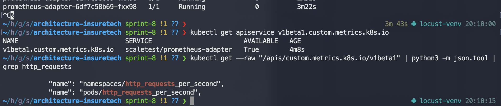

### Проверка HPA по RPS

До 20:13 работал HPA по памяти и держал 10 подов. После замены на hpa-rps число подов меняется вслед за нагрузкой, а после выключения нагрузки падает до 1:
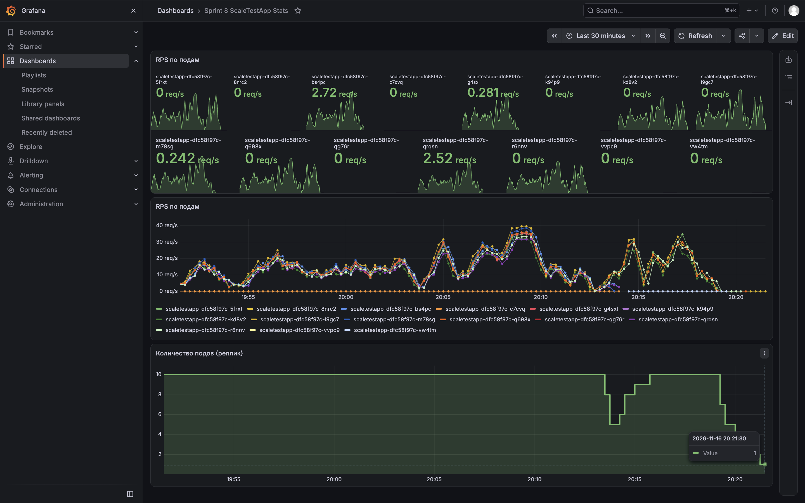

`10146m/10` в TARGETS - это 10.1 запроса в секунду на под при цели 10 (`m` - тысячные доли). Когда RPS падает до 0, HPA примерно за 2 минуты сокращает поды 10 -> 5 -> 4 -> 2 -> 1:
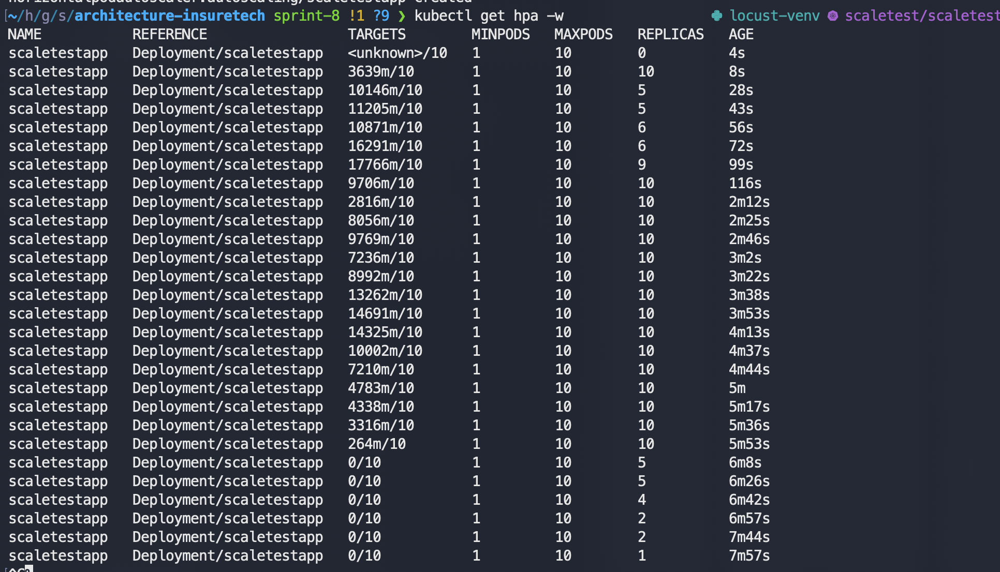
